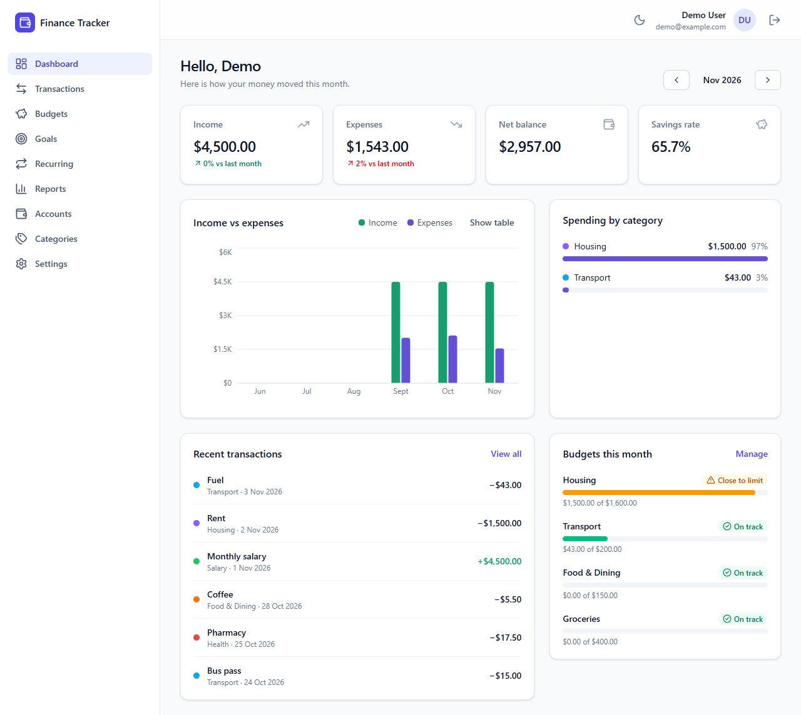
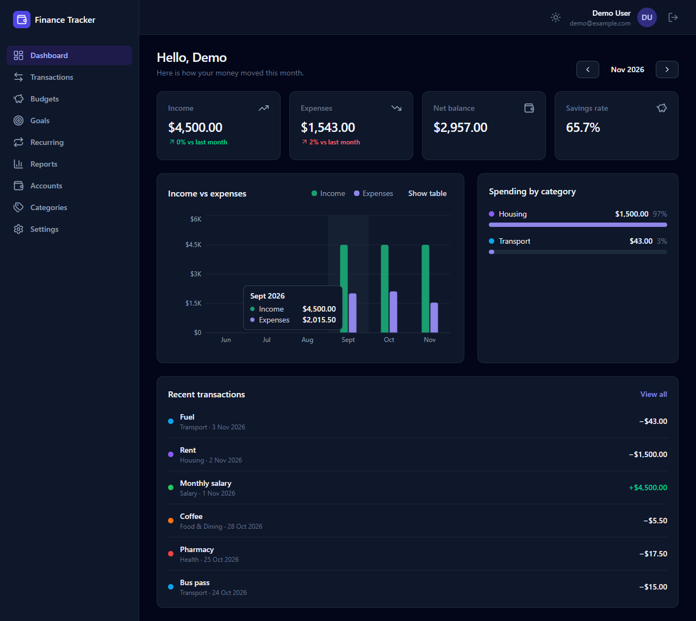
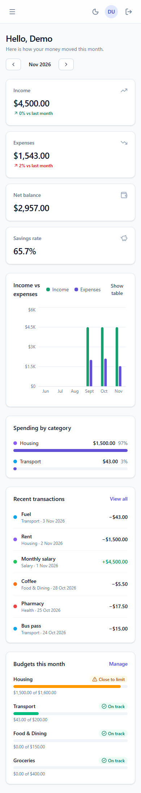

# Finance Tracker

A full-stack personal finance app for tracking income and expenses, setting monthly budgets, saving towards goals and automating recurring bills.

## Features

- **Transactions**: add, edit and delete income and expenses with categories, accounts, tags and notes. Search, filter by type, category, account and date, sort any column, select many to delete at once, and export to CSV.
- **Dashboard**: monthly income, expenses, net balance and savings rate, compared with the same days of last month, plus spending by category and a six-month trend.
- **Budgets**: monthly limits per category with progress, early warnings at a threshold you choose, and one-click copying from last month.
- **Savings goals**: targets with optional deadlines, contributions and withdrawals.
- **Recurring transactions**: daily, weekly, monthly or yearly rules that create transactions automatically, including catching up on missed dates.
- **Reports**: income and spending by category for any period, a 12-month trend and CSV export.
- **Accounts**: cash, bank, credit card, savings and wallet accounts with live balances and net worth.
- **Settings**: display currency, profile, password change and account deletion.
- **Admin**: platform statistics, user search, role changes and user removal.
- **Polish**: dark mode, mobile layout, keyboard-friendly dialogs, reduced-motion support and accessible charts with a table view.

| Dark mode                                                      | Mobile                                                         |
| -------------------------------------------------------------- | -------------------------------------------------------------- |
|  |  |
